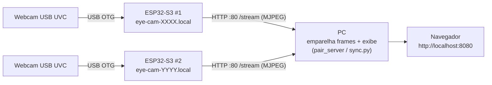

# NeuroEYE — FirmWare Configuration (ESP32-S3)

Firmware para **ESP32-S3** que captura vídeo de uma **webcam USB (UVC)** e o transmite pela rede Wi-Fi em **MJPEG sobre HTTP**. Foi pensado como módulo de captura para **rastreamento ocular** (detecção de pupila): uma placa fica voltada para o olho e, opcionalmente, outra para a cena, e o PC recebe os dois vídeos, sincroniza e processa.

> Autores: Gabrieli Jorge Barbosa, Luan Gabriel e Nycollas Moretz Sohn Goncalves Ramos da Silva · Licença: MIT License

---

## Sumário

- [Funcionalidades](#funcionalidades)
- [Como funciona](#como-funciona)
- [Hardware necessário](#hardware-necessário)
- [Requisitos de software](#requisitos-de-software)
- [Compilando e gravando](#compilando-e-gravando)
- [Primeiro uso: portal Easy Wi-Fi](#primeiro-uso-portal-easy-wi-fi)
- [Acessando o vídeo](#acessando-o-vídeo)
- [Duas câmeras em paralelo e sincronização](#duas-câmeras-em-paralelo-e-sincronização)
- [Parâmetros ajustáveis](#parâmetros-ajustáveis)
- [Limitações conhecidas](#limitações-conhecidas)
- [Solução de problemas](#solução-de-problemas)

---

## Funcionalidades

- Streaming **MJPEG** (`multipart/x-mixed-replace`) de uma webcam USB UVC conectada à porta USB-OTG do ESP32-S3.
- **Easy Wi-Fi Setup:** na primeira execução (ou quando a rede salva não está disponível), a placa abre uma rede própria com uma página para escolher o Wi-Fi e digitar a senha. As credenciais ficam salvas na NVS.
- **Endereço estável pelo nome:** a placa se anuncia por **mDNS** como `eye-cam-XXXX.local` (`XXXX` = últimos dois bytes do MAC). O IP vem do DHCP e pode mudar de roteador para roteador, mas o nome continua o mesmo.
- Reabertura automática da câmera se o cabo USB for desplugado e plugado de novo.
- Memória de vídeo em **PSRAM Octal** (8 MB), para buffers grandes sem faltar RAM para o Wi-Fi.
- Ferramentas para o PC que recebem **duas câmeras**, emparelham os frames pelo horário e exibem tudo numa página HTTP.

## Como funciona



Dentro do firmware:

1. O driver **UVC host** entrega cada frame JPEG por callback (tarefa fixada no Core 1).
2. O callback copia o frame mais recente para um buffer compartilhado, protegido por mutex.
3. O servidor HTTP (Core 0) copia esse frame para um buffer local de cada cliente e o envia pela rede, sem segurar o mutex durante o envio.
4. Rotas: `/` (página simples com o vídeo) e `/stream` (MJPEG puro).

## Hardware necessário

| Item | Detalhe |
|---|---|
| Placa | **ESP32-S3-N16R8** (16 MB de flash, 8 MB de PSRAM **Octal**) com USB-OTG |
| Câmera | Webcam **UVC** que entregue **MJPEG** (a maioria das webcams baratas entrega) |
| Cabo/adaptador | Adaptador USB-OTG para ligar a webcam na porta **USB/OTG** da placa |
| Alimentação da câmera | A porta OTG precisa fornecer **5 V (VBUS)** à webcam. Em muitas placas é preciso fechar o jumper/pad "USB-OTG" ou usar um hub USB alimentado |
| Rede | Wi-Fi **2,4 GHz** |

Observações sobre a placa:

- Placas com duas portas USB: use a porta **UART/COM** para gravar e ver o log, e a porta **USB/OTG** para a webcam.
- Os GPIOs **35, 36 e 37** ficam reservados pela PSRAM Octal. Os pinos USB do S3 são GPIO19 (D−) e GPIO20 (D+).

## Requisitos de software

- **ESP-IDF 6.x** (testado com 6.2).
- Componentes do registro da Espressif (instalados pelo `idf_component.yml`):

  ```yaml
  dependencies:
    espressif/usb_host_uvc: "^2.0.0"
    espressif/mdns: "*"
  ```

- No PC (para as ferramentas de recepção): Linux com `libcurl` e `libturbojpeg` (versão em C) ou Python 3 com OpenCV, Flask e requests (versão em Python).

## Compilando e gravando

```bash
cd NeuroEYE/Firmware
idf.py set-target esp32s3
idf.py build
idf.py -p /dev/ttyACM0 flash monitor      # ajuste a porta (ttyACM0 / ttyUSB0)
```

### Configuração do `sdkconfig`

O projeto depende destes ajustes. O jeito mais seguro é mantê-los em `sdkconfig.defaults` (apague o `sdkconfig` antigo antes de recompilar, porque os valores já existentes nele vencem os defaults):

```
# PSRAM Octal (N16R8) e flash de 16 MB
CONFIG_SPIRAM=y
CONFIG_SPIRAM_MODE_OCT=y
CONFIG_SPIRAM_SPEED_80M=y
CONFIG_ESPTOOLPY_FLASHMODE_QIO=y
CONFIG_ESPTOOLPY_FLASHFREQ_80M=y
CONFIG_ESPTOOLPY_FLASHSIZE_16MB=y

# Webcams UVC têm descriptors grandes
CONFIG_USB_HOST_CONTROL_TRANSFER_MAX_SIZE=1024

# Recomendados para o desempenho do vídeo
CONFIG_FREERTOS_HZ=1000
CONFIG_LWIP_TCP_SND_BUF_DEFAULT=32768
```

No log de boot você deve ver `esp_psram: Found 8MB PSRAM device`. Se aparecer `quad_psram: PSRAM chip is not connected`, o modo da PSRAM está errado (veja a [solução de problemas](#solução-de-problemas)).

## Primeiro uso: portal Easy Wi-Fi

1. Ligue a placa sem nenhuma rede salva. Ela abre a rede **`EyeCam-Setup-XXXX`** (aberta, sem senha).
2. Conecte o celular ou o PC nessa rede e abra **`http://192.168.4.1`**.
3. Escolha sua rede Wi-Fi (2,4 GHz), digite a senha e toque em **Salvar e Conectar**.
4. A página mostra o IP recebido e o nome mDNS. Em seguida a placa reinicia no modo câmera.

Se a rede salva não estiver disponível (por exemplo, a placa foi levada para outro lugar), depois de algumas tentativas o portal reabre sozinho. Para apagar a rede salva à força: `idf.py erase-flash` e grave o firmware de novo.

## Acessando o vídeo

No log de boot aparecem o IP e o nome:

```
I eye:stream: Conectado! Abra http://192.168.0.105/stream
I eye:stream: mDNS ready — http://eye-cam-a004.local/stream
```

| Endereço | O que é |
|---|---|
| `http://<ip>/` ou `http://eye-cam-XXXX.local/` | Página com o vídeo |
| `http://<ip>/stream` ou `http://eye-cam-XXXX.local/stream` | Stream MJPEG puro (para OpenCV, `curl`, `pair_server`...) |

Exemplo em Python:

```python
import cv2
cap = cv2.VideoCapture("http://eye-cam-a004.local/stream")
ok, frame = cap.read()
```

**Resolvendo `.local` no Linux:** instale `sudo apt install avahi-daemon libnss-mdns` e confira que a linha `hosts:` de `/etc/nsswitch.conf` contém `mdns4_minimal [NOTFOUND=return]` antes de `dns`. Teste com `getent hosts eye-cam-XXXX.local`. Windows 10+, macOS e iOS resolvem `.local` nativamente; no Android depende da versão. Redes de convidados ou corporativas costumam bloquear mDNS: nesses casos use o IP.

## Duas câmeras em paralelo e sincronização

Cada placa roda o mesmo firmware e recebe um nome próprio (`eye-cam-XXXX`). As webcams capturam de forma independente e o Wi-Fi acrescenta atraso variável, então a sincronização é feita **por software, no PC**, emparelhando cada frame da câmera A com o frame mais próximo da câmera B.

- **`pair_server.c`** (C, `libcurl` + `libturbojpeg`): lê os dois streams, emparelha, junta lado a lado e serve numa página HTTP.

  ```bash
  sudo apt install libcurl4-openssl-dev libturbojpeg0-dev
  gcc -O2 -o pair_server pair_server.c -lcurl -lturbojpeg -lpthread
  ./pair_server http://eye-cam-AAAA.local/stream http://eye-cam-BBBB.local/stream 8080
  ```

- **`sync.py`** (Python, OpenCV + Flask): mesma lógica, com a vantagem de poder rodar o rastreamento de pupila direto sobre os frames decodificados.

  ```bash
  python3 -m venv .venv && source .venv/bin/activate
  pip install opencv-python numpy requests flask
  python sync.py http://eye-cam-AAAA.local/stream http://eye-cam-BBBB.local/stream 8080
  ```

  > O `requirements.txt` com versões fixas (`numpy==1.24.3`, `opencv-python==4.8.0.74`) não tem pacotes prontos para Python 3.12 ou mais novo. Nesse caso, instale sem fixar as versões, como acima.

Abra `http://localhost:8080`. A cada 2 s o terminal imprime os fps de cada câmera, os pares por segundo, a diferença média de tempo entre os pares e os descartes.

**Regras do emparelhamento:** espera até 80 ms pelo frame da outra câmera; descarta o par se a diferença passar de 50 ms. Por padrão usa o horário de **chegada** dos frames no PC. Para maior precisão, o firmware pode enviar um cabeçalho `X-Timestamp` por frame (com o relógio acertado por SNTP), que as duas ferramentas já sabem ler. Não misture: ou as duas placas enviam o cabeçalho, ou nenhuma.

## Parâmetros ajustáveis

No `main/main.c`:

| Constante | Padrão | Observação |
|---|---|---|
| `UVC_WIDTH` × `UVC_HEIGHT` | 640 × 480 | A câmera precisa oferecer MJPEG nessa resolução |
| `UVC_FPS` | 15 | A câmera precisa oferecer esse fps em MJPEG |
| `UVC_MAX_FRAME_SIZE` | 256 KB | Se aparecer `Overflow de frame buffer`, aumente ou reduza a resolução |

Para listar o que a webcam suporta, ligue-a num PC Linux: `v4l2-ctl --list-formats-ext -d /dev/video0` e procure entradas `MJPG`.

**Sobre 60 fps:** o USB do ESP32-S3 é Full-Speed (12 Mbps) e o Wi-Fi sustenta algo entre 10 e 20 Mbps de TCP. Na prática 60 fps só cabe em resoluções baixas (como 320×240); em 640×480 o mais realista é 15 a 30 fps.

## Limitações conhecidas

- O servidor HTTP do ESP atende **uma requisição por vez**, e um stream não termina. Enquanto alguém assiste ao `/stream` de uma placa, qualquer outra conexão com **a mesma placa** (segunda aba, outro aparelho, o `pair_server` rodando em paralelo) fica esperando. Use **um espectador por placa**.
- Só Wi-Fi **2,4 GHz**.
- Sem HTTPS nem autenticação no stream, e o portal de configuração é uma rede **aberta**: use apenas em rede local de confiança.
- mDNS não funciona em redes que bloqueiam multicast ou isolam clientes (AP isolation).

## Solução de problemas

| Sintoma | Causa provável | O que fazer |
|---|---|---|
| `PSRAM chip is not connected, or wrong PSRAM line mode` e depois `ESP_ERR_NO_MEM` em `esp_wifi_init` | PSRAM configurada como Quad num módulo N16R8 (Octal) | `CONFIG_SPIRAM_MODE_OCT=y`, apagar o `sdkconfig` e recompilar do zero |
| `ENUM: Configuration descriptor larger than control transfer max length` | Buffer de controle USB pequeno demais para o descriptor da webcam | `CONFIG_USB_HOST_CONTROL_TRANSFER_MAX_SIZE=1024` (ou 2048/4096) |
| Webcam sem LED / não detectada | A porta OTG não fornece 5 V | Fechar o jumper USB-OTG da placa ou usar hub USB alimentado |
| `uvc_host_stream_open` falha com `ESP_ERR_NOT_FOUND` | A câmera não oferece MJPEG nessa resolução/fps | Ajustar `UVC_WIDTH/HEIGHT/FPS` conforme o `v4l2-ctl` |
| Funciona pelo IP, mas o `.local` não abre | O PC não resolve mDNS | Instalar `avahi-daemon` e `libnss-mdns`; testar com `getent hosts` |
| Página fica "carregando" e não mostra o vídeo | Outro cliente já está no `/stream` da mesma placa, ou a câmera não está entregando frames | Fechar outras abas e parar `pair_server`/`sync.py`; testar com `curl -m 5 -s http://<ip>/stream \| wc -c` (0 = sem frames) |
| Vídeo travando com duas câmeras | Wi-Fi saturado ou envio em muitos pacotes pequenos | Reduzir resolução/fps, PC no cabo, `CONFIG_LWIP_TCP_SND_BUF_DEFAULT=32768`, `CONFIG_FREERTOS_HZ=1000` |
| Aviso `phy_init: calibration data MAC check failed` | O primeiro byte do MAC lido mudou entre boots | Inofensivo: a placa recalibra o rádio. O nome mDNS usa só os dois últimos bytes e não é afetado |
| `Error: device reports readiness to read` no topo do monitor | O monitor reiniciando a placa pela USB | Pode ignorar |

## Modelo 3D com suporte para as cameras e passadores de fios

[](hardware/3d/suporte_oculos.stl)

*Clique na imagem acima para abrir e girar o modelo 3D interativo (`.stl`) diretamente no GitHub.*

## Estrutura do repositório (resumo)

```
NeuroEYE/
└── Firmware/
    ├── main/main.c           # câmera UVC, Wi-Fi/portal, mDNS e servidor HTTP
    ├── sdkconfig.defaults    # ajustes de PSRAM, flash, USB e rede
    └── CMakeLists.txt

```

_Ajuste esta árvore para refletir a organização real do seu repositório._
